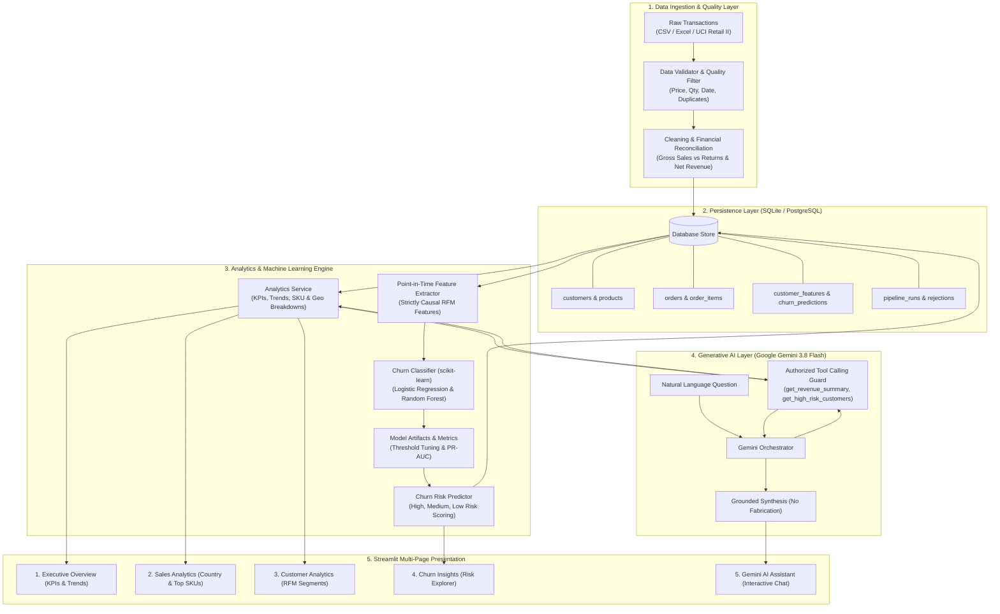

# InsightHub — Intelligent Data Analytics & Churn Prediction Platform

[](https://www.python.org/)
[](https://www.sqlite.org/)
[](https://scikit-learn.org/)
[](https://streamlit.io/)
[](https://ai.google.dev/)
[](https://docs.pytest.org/)
[](#)

An enterprise-grade, modular analytics and customer intelligence platform. Ingests raw e-commerce sales transactions, reconciles commercial revenue, computes point-in-time RFM features without data leakage, predicts customer churn with supervised machine learning, and provides grounded conversational analytics powered by **Google Gemini 3.8 Flash**.

---

## 🏗️ High-Level Design (HLD)



---

## 📁 Repository Structure

```
InsightHub/
├── .github/workflows/ci.yml          # GitHub Actions CI workflow (lint, test, smoke test)
├── app/                              # Streamlit Dashboard Presentation Layer
│   ├── Home.py                       # Main platform landing page & uploader
│   ├── components/                   # Reusable UI widgets, KPI cards & Plotly charts
│   │   ├── charts.py                 # Multi-metric revenue & RFM Plotly visualizations
│   │   ├── filters.py                # Standardized sidebar filter controls
│   │   ├── kpi_cards.py              # Glassmorphic KPI metric cards
│   │   └── ui_helpers.py             # Custom CSS, empty states, and alert banners
│   └── pages/                        # Multi-page dashboard views
│       ├── 1_Executive_Overview.py   # Gross sales, returns, and revenue trajectory
│       ├── 2_Sales_Analytics.py      # Geographic revenue & top product velocity
│       ├── 3_Customer_Analytics.py   # RFM distributions & behavioral segments
│       ├── 4_Churn_Insights.py       # ML risk scores & model diagnostics
│       └── 5_Gemini_AI_Assistant.py  # Grounded Gemini 3.8 Flash chat interface
├── src/                              # Core Domain Business Logic
│   ├── config/                       # Settings (Pydantic) & structured logging
│   ├── data/                         # Ingestion pipeline, cleaning, and schemas
│   ├── database/                     # SQLAlchemy models, connection, and repository
│   ├── analytics/                    # Parameterized KPI aggregations and SQL queries
│   ├── features/                     # Point-in-time causal RFM feature extraction
│   ├── ml/                           # Churn definition, scikit-learn pipeline & eval
│   ├── llm/                          # Gemini client, authorized tools & orchestrator
│   └── utils/                        # Custom exceptions, hashing, and decimal helpers
├── scripts/                          # Command-Line Operational Tools
│   ├── ingest_data.py                # Ingest CSV/Excel transaction files
│   ├── train_model.py                # Train churn classifier with temporal split
│   ├── generate_predictions.py       # Compute customer risk scores & persist to DB
│   └── seed_demo_data.py             # Generate & ingest synthetic retail test fixture
├── tests/                            # Automated Pytest Suite (21 Unit & Integration Tests)
│   ├── conftest.py                   # In-memory SQLite fixtures & mock datasets
│   ├── test_data_pipeline.py         # Validation, cleaning, and idempotency tests
│   ├── test_analytics.py             # KPI formula & revenue calculation tests
│   ├── test_ml.py                    # Feature temporal leakage & ML metrics tests
│   └── test_llm.py                   # Tool parameter validation & mock Gemini tests
├── data/                             # Data directory (SQLite DB, raw, processed)
│   ├── ecommerce.db                  # Local SQLite database
│   └── raw/                          # Raw transaction datasets
├── artifacts/models/                 # Serialized model (.joblib) & metadata (.json)
├── sql/                              # SQL schema DDL and migrations
├── .env.example                      # Configuration template
├── requirements.txt                  # Pinned Python package dependencies
├── Dockerfile                        # Multi-stage container deployment file
└── docker-compose.yml                # Docker Compose orchestration
```

---

## ⚡ Quick Start Guide

### 1. Installation
Clone the repository and install dependencies in a virtual environment:
```bash
python -m venv .venv
# Windows:
.venv\Scripts\activate
# Linux/macOS:
source .venv/bin/activate

pip install -r requirements.txt
```

### 2. Configuration
Copy `.env.example` to `.env` (pre-configured for SQLite and Gemini 3.8 Flash):
```ini
GEMINI_API_KEY=your_actual_gemini_api_key_here
GEMINI_MODEL=gemini-3.8-flash
DATABASE_URL=sqlite:///./data/ecommerce.db
```

### 3. Seed Demo Data & Train Model (One-Time Setup)
```bash
# 1. Generate and ingest 500 synthetic transactions into SQLite:
python scripts/seed_demo_data.py --records 500 --ingest

# 2. Train the churn classifier:
python scripts/train_model.py --version v1.0.0 --horizon-days 60 --lookback-days 180

# 3. Score active customers and persist churn predictions:
python scripts/generate_predictions.py --version v1.0.0
```

### 4. Launch the Dashboard
```bash
streamlit run app/Home.py
```
Open **[http://localhost:8501](http://localhost:8501)** in your browser.

---

## 🎯 Key Capabilities

| Component | Technical Implementation | Business Value |
| :--- | :--- | :--- |
| **Financial Reconciliation** | Net Revenue = Gross Sales - Returns & Cancellations | Exact revenue metrics accounting for returns and discounts |
| **Idempotent Ingestion** | Deterministic SHA-256 line-hash uniqueness | Repeated data loads never duplicate transactions or revenue |
| **Zero-Leakage ML** | Point-in-time RFM extraction strictly prior to snapshot $T$ | Defensible churn prediction without future observation leakage |
| **Risk Segmentation** | Calibrated probability cutoffs (High $\ge 65\%$, Medium, Low) | Actionable retention prioritization for high-value accounts |
| **Grounded AI Assistant** | Tool calling with parameter validation via `google-genai` | Natural-language Q&A with zero hallucinated figures |
| **Dual Database Support** | SQLite (zero-config local) & PostgreSQL (production) | Frictionless local development with seamless cloud scale |

---

## 🧪 Automated Testing

Run the complete test suite (all database operations and LLM calls are mocked):
```bash
pytest tests/ -v
```
**Test Coverage Summary**:
- `test_data_pipeline.py`: Validation rules, invalid price/qty rejection, cancellation isolation, duplicate tracking.
- `test_analytics.py`: Net revenue, AOV, repeat purchase rates, revenue contribution formulas.
- `test_ml.py`: Temporal leakage prevention, incomplete outcome handling, probability calibration.
- `test_llm.py`: Tool argument validation, date parsing, SQL injection blocking, mock Gemini tool turns.

---

## 🐳 Docker Deployment

To run with PostgreSQL 16 and Streamlit in Docker:
```bash
docker-compose up -d --build
```
Access the application at `http://localhost:8501`.
